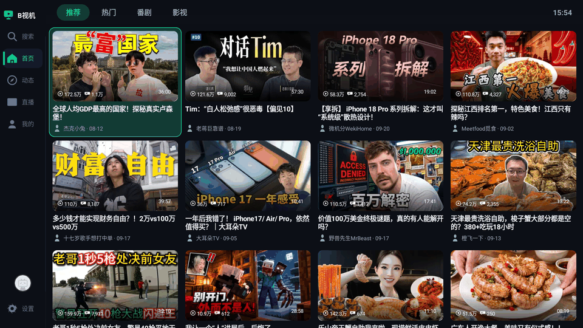

[English](README.md) | [简体中文](README.zh-CN.md) | **日本語** | [한국어](README.ko-KR.md)

---

# <p align="center">B视机 · BTelly</p>
<p align="center"><strong>非公式 Bilibili Android TV / 車載端末 クライアント | デュアル再生コア · 弾幕コメント · スキップアシスタント · 青少年モード | Android 6.0 → 15 全世代対応 | Kotlin · MVVM · Koin · 広告なし</strong></p>
<p align="center">
    <a href="https://github.com/qaqmin/btelly/releases/latest">
        
    </a>
    <a href="https://github.com/qaqmin/btelly/issues">
        
    </a>
    
    
    
</p>

---

> ### 👤 メンテナーの近況 / Maintainer's Corner
> 本プロジェクトは余暇を利用してメンテナンスしており、リモコンでの実機検証と Mac のリモートビルドマシンで継続的に成果物を出しています。
> 報告されたバグは、ひとつずつ丁寧に調査し、ひとつずつ修正しています。
>
> - 📺 **テスト端末**：Android テレビボックス（リモコン操作での検証が中心）、車載表示モードへの対応も両立
> - 🚗 **車載モード**：設定内でワンタップ切り替え。文字とタッチ間隔を一律約 25% 拡大し、テレビモードは一切変化なし
>
> 📌 **アカウント移行のお知らせ（2026-10-10）**：本プロジェクトの GitHub アカウントは二度にわたり停止されました——**min09577** と **qaqmin09577** が相次いでやむを得ない理由で BAN され（リポジトリはすべて 404）、ここに2人の犠牲アカウントを記します。
> プロジェクトは新アカウント **[qaqmin](https://github.com/qaqmin/btelly)** へ全面移行しました。
> Codeberg ミラー（min09577/btelly）は同期更新を継続し、予備チャネルとして提供します。
> アプリ内の「更新を確認」は **GitHub / Codeberg のデュアルチャネル検出**に対応し、両者のうち最新バージョンを自動的に取得します。
> 署名鍵は変更のないため、上書き更新もシームレスに行えます。

---

## ☕ お気持ちスポンサー (Sponsor)

本プロジェクトは余暇に「好きで」書いたもので、皆さんのお役に立てれば本当に嬉しいです。ただしプロジェクトが充実するにつれ、テストで消費する API トークンは想定を超え、長時間のデバッグで休息時間もかなり削られています（笑）。

もし本プロジェクトが問題を解決してくれたり、試行錯誤の時間を省くお役に立てたら、お気持ちをいただけると嬉しいです。ご支援は高額な API の請求を「回復」させるためにすべて使われ、これが安心して更新を続けられる最大の原動力です。

もちろん完全に任意です。決してプレッシャーは感じないでください。便利だと感じていただけたら、**Star** を付けていただくだけでも大きな励ましになります！

> **Tip:** 高額な送金手数料を避けるため、**BNB Smart Chain (BEP-20)** ネットワークでの送金をお勧めします。ご支援ありがとうございます！

<p align="center">
    
</p>

<p align="center"><i>Binance 受取用 QR コード · Binance Wallet QR（USDT · BNB Smart Chain / BEP-20）</i></p>

---

## ✨ B视机を選ぶ理由 / Why BTelly

| 機能 | 説明 |
|------|------|
| 📺 **テレビ / 車載のデュアル形態** | リモコン操作のために設計。車載モードでは文字と間隔を一律約 25% 拡大、7 種類のスキンを全体に適用 |
| 🎬 **サイト全体の動画** | アニメ、映画、ドラマ、UGC。ホームに おすすめ / 人気 / ランキング / アニメ / 映像 の 5 つのタブ |
| 🔀 **デュアル再生コア** | ExoPlayer / IjkPlayer を自由に切り替え、次回再生から適用。IjkPlayer は全 ABI 同梱のため追加ダウンロード不要 |
| 📡 **ライブ & CCTV** | ライブ弾幕をリアルタイム表示。CCTV 1〜17 チャンネルをリモコンの上下で直接切替 |
| 💬 **弾幕エンジン** | Protobuf プロトコルを解析し、人物領域を賢く回避。T9 キーボードで弾幕送信 |
| 🗨️ **プレイヤー内コメント** | 再生中 → その他の操作 → コメント。コメント欄がプレイヤー上に直接重なり、BACK ですぐプレイヤーに戻れ、再生中の画面を見逃しません |
| ✈️ **スキップアシスタント** | 商品紹介 / オープニング / エンディング区間を自動スキップ、シークバーに区間マークを表示 |
| 🎮 **インタラクティブ動画 / Douyin モード** | インタラクティブ分岐の選択。Douyin モードは上下スワイプでおすすめのフィードを切替 |
| 👶 **青少年モード** | 設定内でワンタップのペアレンタルコントロールによるコンテンツフィルタ。隠し操作は不要 |
| 🔍 **検索 / お気に入り / 履歴** | 検索から直接再生、お気に入りのカード積み重ね、視聴進度からの自動再開 |
| ✨ **Min化 アニメーション** | フォーカスバネ / リスト浮き上がり / Hero トランジション。総スイッチひとつでアニメーションゼロの即表示に戻せる |
| 📲 **QR-code ログイン** | TV 側で QR-code を読み取りすばやくログイン。認証情報はローカルのみに保存 |
| 🔒 **プライバシー優先** | トラッキングは一切なし、Bilibili API との通信のみ。ユーザーデータの収集・アップロードは行いません |
| 📱 **超広い世代対応** | Android 6.0 (API 23) から Android 15 (API 35) まで横断的に対応 |

---

## 📖 概要

B视机（BTelly）は **非公式** の Bilibili Android TV / 車載端末クライアントです。Kotlin で記述され、
MVVM + Koin アーキテクチャ、青碧を基調としたダークな独自デザイン言語を採用しています。テレビのリモコンと車載端末での操作を前提に設計されています：
大きなフォーカス、広い間隔、リモコンだけで完結する操作性で、ホームの閲覧、動画再生、弾幕インタラクションからドラマ・アニメの視聴までを一通りカバーします。

> **⚠️ 注意：** 本ソフトウェアおよびソースコードは学習・交流のみを目的としており、商業利用は厳禁です。Bilibili 社とは無関係です。

### 🛠️ 技術スタック / Tech Stack

- **Kotlin 2.1.0** · MVVM + Koin 依存性注入
- **Coroutines + Flow + LiveData** 非同期処理
- **Retrofit + OkHttp + Gson** ネットワーク層
- **Media3 (ExoPlayer) / IjkPlayer** デュアル再生コア（CCTV は WebView を使用）
- **弾幕エンジン**（Protobuf プロトコル解析）
- **DataStore Preferences** データ保存
- **AndroidX** UI コンポーネント
- **minSdk 23 (Android 6.0)** / **targetSdk 35 (Android 15)**

## 📷 アプリのスクリーンショット

ホーム（おすすめ / 人気 / ランキング / アニメ / 映像）


再生と弾幕


動画詳細


本機について & 更新を確認


## 🆕 v3.1.0 — ライブ「フォロー中」全面リニューアル

> ### 🏆 フォロー中の配信者を全量表示 · 配信状態がひと目でわかる
> ライブページの「フォロー中」セクションタイトルで OK を押すとフォローリストページが開き、
> **フォロー中の配信者を全員ページングで表示**します（ホームの少量プレビューモジュールに制限されません）。
> グループ表示——「配信中」は OK で直接配信ルームへ、「配信外」は OK でその人のユーザーページへ。
> 上部のサマリーには「配信中 N · 配信外 M」をリアルタイム表示。ホームのフォローモジュールのルームクリックも修正しました。

## 🆕 v3.0.9 — サイト全体のランキング + プレイヤー内コメントの入り口

> ### 🏆 ランキングタブ + プレイヤー内コメント
> ホームに「ランキング」タブを追加（おすすめ / 人気 / ランキング / アニメ / 映像の 5 つ）。
> プレイヤーの「その他の操作」パネルにコメントの入り口を追加し、コメント欄がプレイヤー上に直接重なり、BACK で再生に戻っても中断しません
> （ついでにコメント欄コンテナの欠落によるクラッシュを 1 件修正）。更新確認はデュアルチャネルにアップグレードされました。

## 🆕 v3.0.8 — Hero トランジション：表紙が詳細ページに飛び込む

> ### 🖼️ カードをタップすると、表紙が自分で飛んでいく
> 動画カードをタップして詳細ページに移動すると、表紙がカードの元の位置からヒーロー位置まで飛びます（300ms の減速イージング、角丸は飛行に合わせて遷移）。
> 戻るを押すとカードへ飛んで戻り、詳細ページ内で関連動画をタップしても同様に連鎖します。ホーム / フィード / 検索 / お気に入り / 履歴のすべてのカードの入り口に対応。
> 詳細データの取得が遅い場合や API が失敗した場合は 2.5s 待機して自動的に取り下げ、ページをブロックしません。「Min化」総スイッチで制御されます。

## 🆕 v3.0.7 / v3.0.6 — Min化 アニメーションを全面展開

> ### 🎞️ リスト浮き上がり + ダイアログのバネ
> ホーム / ライブなどのリストが初回表示時に stagger 浮き上がり（子項目は 12% ずつの遅延、14% 上移動 + フェードイン）。
> 全 16 箇所のダイアログがバネ表示（0.92 倍拡大の戻り + フェードイン）、ホーム / ライブのページ切替はフェードイン——
> すべて「Min化」総スイッチで制御され、オフ時はアニメーションゼロで即表示されます。

## 🆕 v3.0.5 — Min化 アニメーション総スイッチ

> ### 🎛️ 一つのスイッチ、二つの性格
> 設定 → インターフェースに「Min化」総スイッチ（デフォルト ON）を追加。オフにするとサイト全体のアニメーションがゼロになり、
> システムの「動きを減らす」と同等の効果で、低性能端末やアニメーションに敏感なユーザーにも優しい設計です。

## 🆕 v3.0.4 — フォーカスバネ：リモコンにも "Apple な心地よさ"

> ### 🍏 アニメーション基盤の導入
> 動画カード、タブチップ、ナビゲーションレール、設定行がフォーカスされた際にわずかに拡大して戻り、階層が上がります。
> 非フォーカス時は減速して戻ります——UiMotion / UiFocusMotion のセントラルトークンで統一駆動します。

## 🆕 v2.1.0 — B视机 に改名 · デュアル再生コアの時代

> ### 🔀 ExoPlayer / IjkPlayer 自由切替
> 「再生コア」設定を追加。IjkPlayer は動画とライブ再生に対応（DASH のデュアルトラックをローカル MPD で統合、
> ライブは FLV/HLS に直接接続）、コアの .so は全 ABI 同梱。Media3 Player のファサードとして実装しているため、
> 弾幕 / シーク / 操作の既存の連携は一切変更不要です。青少年モードは設定内の直接スイッチに変更し、ワンタップで使えます。
>
> ### 🏷️ ブランド統一
> インターフェース、アイコン、コードのパッケージ名、リポジトリ名を B视机（BTelly）に統一し、インストール識別子は com.btelly に切り替わりました。

## 💡 使用のコツ / Pro Tips

| 場面 | 推奨 |
|------|------|
| 🕹️ **リモコンだけの操作** | OK で再生 / 決定、BACK で段階的に戻る。動画カードの長押しでクイックメニューを表示 |
| 💬 **コメントを見る** | 再生中 → その他の操作 → コメント。BACK でプレイヤーに戻り、再生は中断しません |
| ✍️ **弾幕を送る** | 再生中 → その他の操作 → 弾幕を送信。T9 キーボードで入力し、エンターで送信 |
| ✈️ **スキップアシスタント** | プレイヤーのシークバーにスキップ可能な区間が自動的にマークされ、設定に従います |
| 👶 **青少年モード** | 設定 → 青少年モード。ワンタップで有効になり、不適切なコンテンツをブロックします |
| 🔄 **更新を確認** | 設定 → 本機について → 更新を確認（GitHub / Codeberg のデュアルチャネルで最新版を取得） |
| 🐛 **トラブル対応** | 本機についてページでログを表示 → コピーし、issue 報告時に添付すると対応がスムーズです |

## 💬 フィードバックと貢献 / Feedback and Contribution

🐛 バグを見つけましたか？💡 アイデアがありますか？GitHub Issues からお気軽にどうぞ：

<p align="center">
    <a href="https://github.com/qaqmin/btelly/issues">
        
    </a>
</p>

> 報告時に**アプリのログ**（本機について → ログを表示 → コピー）を添付してください。詳しいほど修正は早くなります。

## 👨‍💻 原作者 / Original Author

本プロジェクトは **[QAQMin (min09577)](https://github.com/qaqmin)** が開発・メンテナンスしています。
2026-09 に B视机（BTelly）へ改名しました。

> 🙏 **ほとんどの画面と操作ロジックは [BBLL](https://github.com/xiaye13579/BBLL) を参考にしています**。
> 一部の主要機能は PiliPlus / BiliPai / Blbl を、Bilibili API の挙動は
> [bilibili-API-collect](https://github.com/SocialSisterYi/bilibili-API-collect) を参考にしました。
> 上記のオープンソースプロジェクトに心から感謝します。

## 🔗 関連リンク

+ [SocialSisterYi/bilibili-API-collect](https://github.com/SocialSisterYi/bilibili-API-collect) - Bilibili API の収集・整理
+ [xiaye13579/BBLL](https://github.com/xiaye13579/BBLL) - 画面と操作ロジックの主な参考実装
+ [bggRGjQaUbCoE/PiliPlus](https://github.com/bggRGjQaUbCoE/PiliPlus) / [jay3-yy/BiliPai](https://github.com/jay3-yy/BiliPai) / [cat3399/blbl](https://github.com/cat3399/blbl) - 一部の主要機能の参考実装

---

## 📋 バージョン履歴 / Version History

| バージョン / Version | 日付 / Date | 説明 / Description |
|---|---|---|
| v3.1.0 | 2026-10-11 | 🏆 **ライブ「フォロー中」リニューアル** — フォロー配信者を全量ページング表示 · 配信中/配信外グループ · 配信外はユーザーページへ · フォローモジュールのクリック修正 |
| v3.0.9 | 2026-10-05 | 🗨️ **プレイヤー内コメント + 全サイトランキングタブ** · デュアルチャネル更新確認 · コメント欄コンテナのクラッシュ修正 |
| v3.0.8 | 2026-09-26 | 🖼️ **Hero トランジション** — 表紙が詳細ページに飛び込む · すべてのカードの入り口に対応 · 戻ると元の位置へ飛んで戻る |
| v3.0.7 | 2026-09-26 | 🎞️ **リストの stagger 浮き上がり** — ホーム / ライブの初回表示で遅延しながら上移動・フェードイン |
| v3.0.6 | 2026-09-26 | 🪀 **ダイアログのバネ表示** — 16 箇所に導入 · ホーム / ライブのページ切替をフェードイン |
| v3.0.5 | 2026-09-25 | 🎛️ **Min化 アニメーション総スイッチ** — ワンタップでアニメーションゼロの即表示に戻せる |
| v3.0.4 | 2026-09-25 | 🍏 **フォーカスバネ** — カード / タブ / ナビゲーションレールのフォーカス時バネ戻り · UiMotion トークン基盤 |
| v3.0.3 | 2026-09-25 | 🚗 **車載の間隔拡張を完成** — ダイアログ + 詳細ページのヘッダーに対応 · テレビモードは変化なし |
| v3.0.2 | 2026-09-25 | 📺 **ライブ配信室のトークン化を完了** — ルームカード / リスト背景 / 空状態のテキストをテーマに統一 |
| v3.0.1 | 2026-09-25 | 🩺 **ライブの音声・映像同期の改善** — HEVC 経路で 14 分間の実機計測、ドリフトなし |
| v3.0.0 | 2026-09-25 | 🎨 **アイコン体系を 56 個すべて描き直し** · 車載モードを全画面に拡張 · お気に入り / ユーザースペースをリニューアル · 古いカラートークンを全廃 |
| v2.1.0 | 2026-09-25 | 🏷️ **B视机 (BTelly) に改名** — パッケージ名を com.btelly に切替 · **デュアル再生コア** · 青少年モードスイッチ · ウェルカムページ / 設定をリニューアル |
| v2.0.4 | 2026-09-18 | 🐛 **弾幕スクロール速度の修正** · ユーザースペースページを作り直し · ユーザー情報ポップアップを公式風に |
| v2.0.3 | 2026-09-10 | 🔤 **UI の文字サイズ 5 段階** · **動画カードのサイズ 4 段階** · ホームの読み込み中表示を修正 |
| v2.0.2 | 2026-09-10 | 🐛 検索結果の混在 / フォーカス消失の修正 · 弾幕の文字サイズ上限 100 · 超ワイド画面で 1 行 8 カード |
| v2.0.1 | 2026-09-10 | 🎫 **試聴の案内を明確化** · 試聴終了後に連続再生を停止 · 一部の読み込みを修正 |
| v2.0.0 | 2026-09-09 | 📦 **パッケージ名変更バージョン**（旧版のアンインストール後に再インストールが必要）· 戻るキーのフォーカス異常を修正 |
| [▶ 完全なログ](CHANGELOG.md) | | それ以前のバージョン（v1.2.0 〜 v1.6.x、2025-04 〜 2026-09）は CHANGELOG.md を参照してください |

---

## 🛠️ ビルド手順 / Build Instructions

### 環境要件 / Prerequisites

- **JDK 17+**
- **Android SDK**（compileSdk 35）
- Android Studio（推奨）

### ビルドコマンド / Build Commands

```bash
# Debug ビルド / Debug Build
./gradlew assembleDebug

# Release ビルド / Release Build
./gradlew assembleRelease
```

ビルド成果物は `app/build/outputs/apk/` ディレクトリに出力され、ファイル名は `BTelly-v<バージョン>-<buildType>.apk` の形式です。

### 署名について / Signing

Release の署名は **Mac リモートビルドマシン** で一元管理しています（プロジェクトごとに 1 つの鍵を一度だけ生成し、再生成することはありません）。
keystore の 3 点セットは **本リポジトリには含まれていません**。ローカルで Release をビルドする場合は、署名設定を各自ご用意ください。

```properties
# keystore.properties（バージョン管理システムにコミットしないこと / Do NOT commit）
storeFile=your_keystore_file.jks
storePassword=your_store_password
keyAlias=your_key_alias
keyPassword=your_key_password
```

> ⚠️ **注意 / Note:** `keystore.properties` および `.jks` ファイルはバージョン管理システムにコミットしないでください。

---

## ⚠️ 免責事項 / Disclaimer

<details>
<summary>🇨🇳 中文</summary>

1. 本软件为**非官方** Bilibili 客户端，与哔哩哔哩（上海宽娱数码科技有限公司）无任何关联。
2. 本软件及源码**仅供学习交流使用，严禁用于商业用途**。
3. 本项目不存储任何视频、弹幕、图片、文字内容，仅作播放呈现；相关内容版权归 Bilibili 及原创作者所有。
4. 本项目不收集、不上传任何用户数据；登录凭据仅保存在本地，不上传至任何第三方服务器。
5. 本项目「按现状」提供，不保证功能可用、稳定或持续更新；因使用本项目产生的任何直接或间接损失，作者不承担责任。
6. 不得在 B 站、官方账号区域（含微博评论区）及微信公众号宣传本项目；不得利用本项目牟利。
7. 若本项目侵犯了您的合法权益，请联系作者，确认后将在第一时间处理或下架。

</details>

<details>
<summary>🇯🇵 日本語</summary>

1. 本ソフトウェアは**非公式**の Bilibili クライアントであり、哔哩哔哩社とは一切の関係がありません。
2. 本ソフトウェアおよびソースコードは**学習・交流のみを目的としており、商業利用は厳禁**です。
3. 本ソフトウェアは動画・弾幕・画像・テキストを一切保存せず、再生呈现のみを行います。
4. 本ソフトウェアはユーザーデータを収集・アップロードしません。ログイン情報はローカルのみに保存されます。
5. 本ソフトウェアは「現状有姿」で提供され、機能の完全性・安定性・継続的な更新を保証するものではありません。

</details>

<details>
<summary>🇰🇷 한국어</summary>

1. 본 소프트웨어는 **비공식** Bilibili 클라이언트이며, 哔哩哔哩와는 아무런 관련이 없습니다.
2. 본 소프트웨어 및 소스코드는 **학습 및 교류 목적으로만 사용되며, 상업적 사용은 엄격히 금지**됩니다.
3. 본 소프트웨어는 영상·탄막·이미지·텍스트를 저장하지 않으며 재생만 제공합니다.
4. 본 소프트웨어는 사용자 데이터를 수집하거나 업로드하지 않습니다. 로그인 정보는 로컬에만 저장됩니다.
5. 본 소프트웨어는 기능의 완전성과 안정성을 보장하지 않습니다.

</details>

<details>
<summary>🇺🇸 English</summary>

1. This software is an **unofficial** Bilibili client and is not affiliated with Bilibili Inc.
2. This software and source code are **for learning and communication purposes only. Commercial use is strictly prohibited**.
3. This project stores no video, danmaku, image, or text content; it only presents playback. All related content copyrights belong to Bilibili and the original authors.
4. This project collects and uploads no user data; login credentials are stored locally only.
5. This software is provided "as is", without warranty of completeness, stability, or continued updates.

</details>

---

<p align="center">
    <sub>メンテナー / Maintainer: <a href="https://github.com/qaqmin">qaqmin</a>（旧 min09577） · Codeberg ミラー：<a href="https://codeberg.org/min09577/btelly">min09577/btelly</a> · ソースコードは学習・交流のみを目的としています</sub>
</p>
